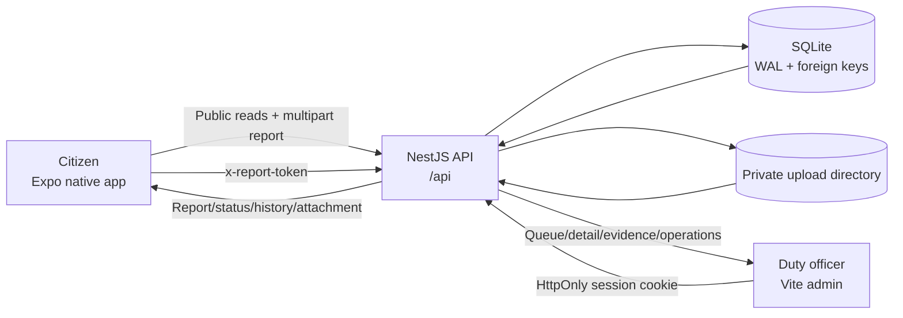

# VNPolice Care — As-built architecture

## Scope

This document describes the repository implementation, not the concept prototype. The system has two user-facing clients connected to one NestJS API and one SQLite database:

- **Citizen surface:** native Expo / React Native application.
- **Operations surface:** Vite / React admin web application.
- **Shared backend:** NestJS REST API, SQLite persistence, and a private filesystem upload directory.

The citizen app is anonymous. It does not collect customer identity, vehicle, insurance, claim amount, or policy data. Its implemented domain is public-safety incident reporting in Cà Mau.

## Workspace

| Path | Runtime | Responsibility |
|---|---|---|
| `apps/mobile` | Expo 54, React Native 0.81, Expo Router, TanStack Query | Map discovery, incident submission, evidence upload, secure device history, live tracking |
| `apps/admin` | Vite 8, React 19, Leaflet | Internal login, incident queue/detail, assignment/status operation, police-unit/place management, review moderation |
| `apps/server` | NestJS 12, Express, better-sqlite3 | Validation, authorization, report workflow, private attachment delivery, persistence, seeding |
| `packages/shared` | TypeScript + Zod | Shared enums, labels, schemas, request types, and response interfaces |
| `apps/server/migrations` | SQLite SQL | Durable schema and migration history |
| `apps/server/seed-assets/incidents` | Local JPEG files | Stable, non-graphic evidence assets copied into private uploads during reset |
| `references` | DOCX / HTML | Product and data source material; not executed at runtime |

Root orchestration is defined by `package.json` and `Makefile`.

## Runtime topology

Default local endpoints:

| Component | Default endpoint |
|---|---|
| API | `http://127.0.0.1:3000/api` or `http://localhost:3000/api` |
| Admin | `http://localhost:5173` |
| Expo Metro | `http://localhost:8081` |
| SQLite | `apps/server/data/vnpolice-care.sqlite` |
| Uploads | `apps/server/uploads` |

## Shared domain contract

`packages/shared/src/index.ts` is the single enum/schema source consumed by all three applications.

- Incident types: `fire`, `traffic_accident`, `fighting`, `public_security`, `other`.
- Report state machine: `submitted -> received -> processing -> resolved`.
- Place categories: `food`, `service`.
- Review states: `pending`, `approved`, `rejected`.
- Zod validates report creation, reviews, login, status, assignment, police units, and places.
- `ReportDetails`, `ReportStatusHistory`, `PoliceUnit`, `Place`, and `Review` are shared response contracts.

The clients do not maintain independent status enums. Vietnamese labels come from `INCIDENT_LABELS` and `STATUS_LABELS`.

## Citizen application

### Navigation

`apps/mobile/app/_layout.tsx` mounts:

- `ReportDraftProvider` for the in-progress incident.
- one TanStack `QueryClient` for remote state;
- an Expo Router native stack;
- tabs for map, report history, and product information.

Implemented routes:

| Route | Screen |
|---|---|
| `/(tabs)` | map, secure report history, information |
| `/report/type` | incident category |
| `/report/location` | GPS/manual incident location and nearest-unit preview |
| `/report/details` | description, image selection/camera, review, upload and retry |
| `/report/result` | receipt and uploaded-evidence confirmation |
| `/report/[id]` | live status timeline, map, assignment and evidence |
| `/police/[id]` | police-unit detail |
| `/place/[id]` | place detail and review submission |

A successful submission resets the root stack to `/(tabs)` → `/report/result`; the receipt then replaces itself with `/report/[id]`, so leaving tracking returns to the tabs instead of the cleared wizard steps.

### State

- The current report draft is React context state in `features/reports/report-draft-context.tsx`.
- Server state is TanStack Query. Tracking and history poll every five seconds only while focused.
- Report capability credentials are stored under `vnpolice-care.report-credentials.v1` in Expo SecureStore with `WHEN_UNLOCKED_THIS_DEVICE_ONLY`.
- Up to 100 report credentials are retained. Credentials rejected with citizen-facing 404 are pruned from the history tab.

### Network and evidence

`services/api.ts` builds `FormData`. `services/report-upload.ts` uses `XMLHttpRequest` because React Native `fetch` does not expose upload progress. It uses the standard Promise constructor for Hermes compatibility.

The mobile picker accepts one JPEG, PNG, or WebP image, requests camera/library permission only on action, uses a compatible iOS representation, and checks a known file size against 5 MiB before submission. The server performs the authoritative MIME, size, and magic-byte checks.

## API and backend

### Bootstrap and middleware

`apps/server/src/main.ts` loads the app-local environment, creates `AppModule`, applies `configureApp`, and listens on `0.0.0.0`.

`configureApp` installs:

- CORS with a configured `ADMIN_ORIGIN` allow-list and credentials;
- Helmet;
- an HttpOnly `vnpc.admin` session cookie (`SameSite=Lax`, eight-hour maximum age);
- report, review, and login rate limits;
- global `/api` prefix;
- a common HTTP error filter.

### NestJS modules

| Module | Responsibility |
|---|---|
| `DatabaseModule` | SQLite connection, migration, seed and lifecycle |
| `PublicModule` | public police-unit/place/review reads and pending review creation |
| `ReportsModule` | citizen report creation and capability-protected report/history/evidence reads |
| `AdminModule` | admin session auth, dashboard, incident operations, reference-data CRUD, moderation |

Controllers use explicit `@Inject` because the `tsx` development path does not emit decorator metadata.

### Report creation

`ReportsController` accepts `multipart/form-data` with optional `attachment`:

1. Multer holds at most one file in memory and enforces 5 MiB.
2. `createReportSchema` validates/coerces the text fields.
3. `ReportsService` validates image magic bytes.
4. A random 32-byte capability token is returned once; only its SHA-256 hash is stored.
5. The nearest active, verified police unit is selected by Haversine distance.
6. The attachment is written under a random UUID filename.
7. Report and initial `submitted` history rows are committed in one SQLite transaction.
8. A failed database transaction removes the just-written file.

### Admin operations

Admin report status can advance only one step. Status update and history insertion occur in one transaction. Assignment accepts an active police unit or `null`. The citizen receives the new report state and history through the same capability-protected APIs polled by the app.

## Authentication and authorization

The system implements two principals, not a general role hierarchy.

| Principal | Credential | Allowed behavior | Backend enforcement |
|---|---|---|---|
| Anonymous citizen/browser | none | public active units/places, approved reviews, pending review submission, report submission | public controllers + validation/rate limits |
| Report owner device | `x-report-token` capability | one report, its status history, and its evidence | report ID plus SHA-256 token match; invalid/missing token returns the same 404 |
| Duty officer admin | `vnpc.admin` HttpOnly cookie | queue/detail/evidence, assignment/status, police-unit/place CRUD, review moderation | class-level `AdminAuthGuard` on operational admin routes |

There is one admin account type and no reviewer/operator/approver distinction. The UI does not merely hide actions: operational API routes require the authenticated server session. The local default session store is in-memory and is not suitable for horizontal production deployment.

## Persistence

SQLite is configured with foreign keys, a five-second busy timeout, and WAL mode.

| Table | Purpose |
|---|---|
| `police_units` | dispatch/reference units, verification, coordinates and activation |
| `places` | map places and verification/source metadata |
| `reviews` | user review content and moderation status |
| `reports` | incident, device/incident coordinates, evidence metadata, units, capability hash and status |
| `report_status_history` | immutable status timeline and actor identifier |
| `admin_users` | bcrypt password hash, display name and active flag |
| `schema_migrations` | applied migration names |

Attachments are not BLOBs and are never statically mounted. SQLite stores the private filename and public metadata; controller routes stream the file only after capability or session authorization.

## Demo data and reset

`npm run demo:reset` (or the lower-level `npm run db:reset` / `make reset`) clears records and stored attachments, then reloads:

- 65 reference-derived police units;
- 14 synthetic Cà Mau places;
- Vietnamese reviews with pending/approved/rejected states;
- 18 relative-time incident reports spanning all statuses;
- local evidence files for three seeded traffic reports;
- one bcrypt-backed admin account from environment values.

The reset transaction operates against the live SQLite connection, so a running API does not observe a partially empty dataset. Device credentials for deleted reports are removed when the mobile history tab receives 404.

## Environment

| Variable | Consumer | Meaning |
|---|---|---|
| `PORT` | server | API port |
| `DATABASE_PATH` | server | SQLite path |
| `UPLOAD_DIR` | server | private evidence path |
| `SESSION_SECRET` | server | session signing secret |
| `ADMIN_USERNAME`, `ADMIN_PASSWORD`, `ADMIN_DISPLAY_NAME` | server seed | local duty-officer account |
| `ADMIN_ORIGIN` | server | credentialed CORS allow-list |
| `COOKIE_SECURE` | server | secure session cookie toggle |
| `AUTO_SEED` | server | seed at startup |
| `VITE_API_URL` | admin | API base URL |
| `EXPO_PUBLIC_API_URL` | mobile | API base URL |
| `GOOGLE_MAPS_ANDROID_API_KEY` | mobile build | Android native map tiles |

## Existing verification surface

- Server Vitest/Supertest integration tests cover the capability boundary, private attachments, assignment, sequential status, persistence, review moderation, CRUD, validation and rate limits.
- Mobile Vitest tests cover the Hermes-safe XHR upload adapter, progress, timeout and offline errors.
- No native UI automation framework was present at audit start.
- No Playwright project was present at audit start; deterministic browser/cross-system coverage is added under `artifacts/tests` by this review.

## Deliberate product boundaries

- No connection to police dispatch, fire, ambulance, insurance, payment, identity, or vehicle registries.
- No citizen account or cloud credential recovery; access remains on the submitting device.
- One optional incident image per report; multiple evidence files are not represented by the current schema.
- Nearest unit is a distance suggestion, not a jurisdiction decision.
- Seed place names/reviews are synthetic; police unit names/hotlines come from the supplied reference.
