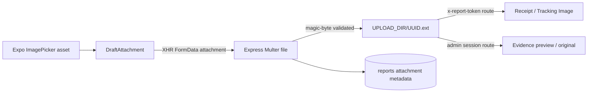

# VNPolice Care — Cross-application data mapping

## Scope

The implemented citizen entity is an anonymous **incident report**, not an insurance claim. Fields such as customer name, phone, vehicle plate/model and monetary amount are absent from the draft, API, schema, database and admin UI. They are therefore marked unsupported rather than invented.

## Incident report creation and display

| Citizen App field / UI | Frontend model | Multipart API field | Shared/backend input | SQLite `reports` column | Admin API / UI | Citizen status UI | Status |
|---|---|---|---|---|---|---|---|
| Incident category | `draft.incidentType` | `incidentType` | `CreateReportInput.incidentType` | `incident_type` | `report.incidentType` -> `INCIDENT_LABELS` in queue/detail | same shared label in receipt/history/tracking | Exact shared enum |
| Description | `draft.description` | `description` when trimmed/non-empty | optional string, max 2,000 | `description` nullable | queue list carries it; detail “Mô tả” | receipt omits it; history card/tracking display when present | Empty becomes `null` |
| Incident latitude | `draft.incidentLocation.latitude` | `incidentLatitude` string | coerced finite number, -90..90 | `incident_latitude` REAL | queue coordinate, detail map and coordinate field | receipt coordinate; tracking map/details | Exact number |
| Incident longitude | `draft.incidentLocation.longitude` | `incidentLongitude` string | coerced finite number, -180..180 | `incident_longitude` REAL | queue coordinate, detail map and coordinate field | receipt coordinate; tracking map/details | Exact number |
| Location source | `DraftLocation.source` (`gps`/`manual`) | not transmitted | not represented | not stored | unavailable | shown only before submit | Intentional local-only metadata |
| Device latitude | `draft.reporterLocation?.latitude` | `reporterLatitude` | optional paired number | `reporter_latitude` REAL nullable | detail “Vị trí thiết bị” | tracking details | Pair invariant |
| Device longitude | `draft.reporterLocation?.longitude` | `reporterLongitude` | optional paired number | `reporter_longitude` REAL nullable | detail “Vị trí thiết bị” | tracking details | Pair invariant |
| GPS accuracy | `draft.reporterLocation?.accuracy` | `gpsAccuracy` | optional 0..100,000 | `gps_accuracy` REAL nullable | detail rounded `±m` | tracking rounded `±m` | Unit is metres |
| Selected image URI | `draft.attachment.uri` | multipart file bytes | `Express.Multer.File.buffer` | not stored | not exposed | local preview only | Device-local URI |
| Image filename | `draft.attachment.fileName` | multipart filename | `attachment.originalname` | `attachment_original_name` | detail/evidence heading | tracking filename | Preserved display metadata |
| Image MIME | `draft.attachment.mimeType` | multipart content type | MIME allow-list + magic bytes | `attachment_mime_type` | response content type, not JSON | response content type, not JSON | JPEG/PNG/WebP only |
| Image byte size | `draft.attachment.fileSize` may be null | computed by Multer | `attachment.size` | `attachment_size` | detail KB label | tracking KB label | Server value authoritative |
| Private image filename | none | none | UUID + extension | `attachment_stored_name` | never returned | never returned | Server-only secret path component |
| Suggested police unit | nearest preview calculated from public units | none | server recalculates by Haversine | `suggested_police_unit_id` | queue/detail `suggestedPoliceUnit` | receipt and fallback tracking unit | Server result authoritative |
| Initial state | none | none | hardcoded `submitted` | `status` | “Đã gửi” | “Đã gửi” | Shared enum |
| Created time | none | none | `new Date().toISOString()` | `created_at` | `createdAt`, formatted `vi-VN` | same | Persisted ISO UTC |
| Updated time | none | none | same as create then operation time | `updated_at` | list response; not visibly labelled | response available; not visibly labelled | Persisted ISO UTC |
| Report ID | none before submit | none | generated `VN-YYYYMMDD-XXXXXX` | `id` | queue/detail | receipt/history/tracking | User-facing identifier |
| Access token | none before submit | none | random 32-byte base64url; SHA-256 hash stored | `access_token_hash` | never exposed | raw token only in SecureStore/request header | Capability boundary |

## Attachment mapping

| Concern | Citizen request path | Admin request path |
|---|---|---|
| Endpoint | `/api/reports/:id/attachment` | `/api/admin/reports/:id/attachment` |
| Authorization | matching `x-report-token` | valid admin session |
| Content type | stored MIME | stored MIME |
| Disposition | inline, encoded original filename | inline, encoded original filename |
| Cache | private, no-store | private, no-store |
| JSON metadata | `attachmentAvailable`, `attachmentOriginalName`, `attachmentSize` | same `ReportDetails` fields |

## Status and history mapping

| Domain event | Shared value | DB state | History `changed_by` | API actor name | Admin UI | Citizen UI |
|---|---|---|---|---|---|---|
| Submitted by citizen | `submitted` | `reports.status`; history row | `citizen-device` | `Người báo tin` | Mới gửi / Đã gửi | Đã gửi tin báo |
| Accepted by duty officer | `received` | status + history transaction | `admin:<username>` | joined `admin_users.display_name` | Đã tiếp nhận | Đơn vị tiếp nhận tin báo |
| Handling started | `processing` | status + history transaction | `admin:<username>` | display name | Đang xử lý | Đang xử lý |
| Completed | `resolved` | status + history transaction | `admin:<username>` | display name | Đã giải quyết | Đã giải quyết |

The persisted enum strings are identical in mobile, shared contracts, server and admin. Only display wording differs intentionally by context.

## Assignment mapping

| Source | API | Stored field | Admin rendering | Citizen rendering |
|---|---|---|---|---|
| Server nearest active+verified unit | included in create response; `suggestedPoliceUnit` | `suggested_police_unit_id` | suggested unit in detail; queue fallback | receipt and tracking fallback |
| Officer select | `PATCH /api/admin/reports/:id/assignment { policeUnitId }` | `assigned_police_unit_id` | selected assigned unit; queue prefers assigned | tracking map/details prefer assigned |
| Officer clears assignment | same endpoint with `null` | SQL `NULL` | “Chưa phân công” while suggestion remains separately visible | tracking falls back to suggestion |

Assignment changes update `reports.updated_at` but do not create status-history rows.

## Police unit mapping

| Admin form / API field | Shared model | SQLite column | Public/mobile use |
|---|---|---|---|
| `name` | `PoliceUnit.name` | `name` | marker, detail, assignment display |
| `administrativeLevel` | same | `administrative_level` | detail |
| `address` | nullable response | `address` | detail |
| `dutyHotline` | nullable response | `duty_hotline` | telephone action |
| `latitude`, `longitude` | nullable paired numbers | `latitude`, `longitude` | marker and distance; both required together |
| `verified` | boolean | integer 0/1 | badge; nearest routing requires true |
| `verificationSource` | nullable | `verification_source` | trust/source display |
| `active` | boolean | integer 0/1 | public query and assignment eligibility |
| `createdAt`, `updatedAt` | ISO strings | `created_at`, `updated_at` | response metadata |

## Place and review mapping

| Citizen/App field | API field | SQLite | Admin field/UI | Public result |
|---|---|---|---|---|
| Place name/category/address/coordinates | matching camelCase fields | `places` snake_case columns | create/edit cards and map | active place map/detail |
| Place verification/source/data source | matching fields | verification/data-source columns | admin form and badges | detail trust metadata |
| Review author | `authorName` | `author_name` | review author | visible after approval |
| Rating | `rating` integer 1–5 | `rating` | `n/5` | approved aggregate and review |
| Review text | `comment` | `comment` | moderation card | visible after approval |
| New review state | server sets `pending` | `status` | default moderation queue | hidden publicly |
| Moderation action | `PATCH { status }` | `approved`/`rejected` | badge/filter | approved only is returned |

## Identifier, number and date transformations

| Value | Transformation |
|---|---|
| FormData numbers | mobile converts to decimal strings; Zod `z.coerce.number()` restores finite numbers |
| SQLite booleans | integer 0/1 mapped with `Boolean(...)` |
| Coordinates | stored as REAL; queue shows 5 decimals, detail 6 decimals, mobile uses 5 decimals |
| Rating average | SQL aggregate mapped to one decimal |
| Dates | server stores ISO UTC; clients call `toLocaleString('vi-VN')` / mobile `formatDateTime` |
| Report IDs | date segment plus random six-character uppercase base-36 suffix; no UUID is exposed in normal UI |
| Capability token | raw token is never stored server-side or returned by admin APIs |

## Nullability and validation invariants

- Incident coordinates and incident type are required.
- Reporter coordinates are both present or both absent.
- Police-unit coordinates are both present or both absent.
- Description, evidence and reporter GPS are optional.
- A report can exist without a suggested or assigned unit.
- Evidence availability derives from `attachment_stored_name`, not from filename or size.
- Verified police units require coordinates and a verification source in admin business validation.
- Verified places require a verification source.
- Public review reads exclude pending and rejected rows.

## Unsupported concept fields

| Requested/example concept | Actual repository status |
|---|---|
| Customer name / phone / email | Not collected for incident reports |
| Personal identity number | Explicitly discouraged in mobile privacy copy |
| Vehicle make/model/plate | Not represented |
| Insurance policy / claim / approver | Not represented |
| Accident monetary amount / VND settlement | Not represented |
| Multiple evidence images | Not represented; one optional attachment |
| Admin approve/reject incident | Not represented; actual workflow is sequential receive/process/resolve |
| Admin notes or request-more-information | Not represented |

These are product boundaries, not hidden demo data. The final scenario uses only the supported anonymous public-safety incident workflow.
