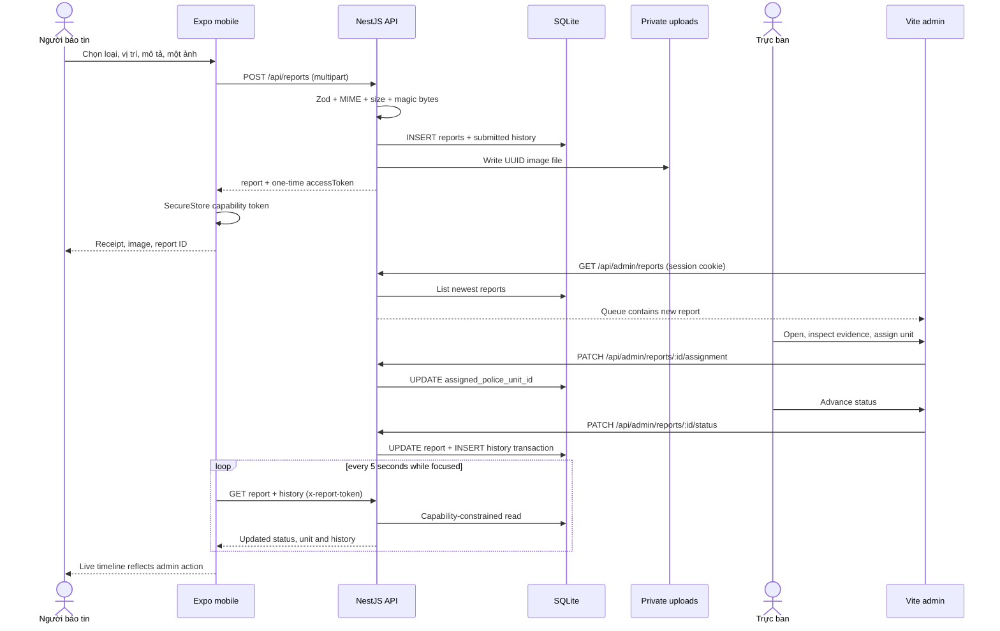
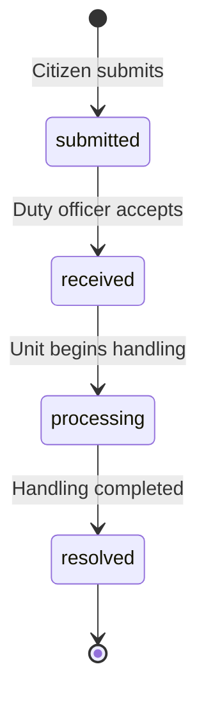

# VNPolice Care — System flow map

## End-to-end report lifecycle

## Actors and access model

| Actor | Surface | Authentication | Supported actions | Not implemented |
|---|---|---|---|---|
| Public user | Mobile / public API | none | map units/places, approved reviews, submit a review, submit an incident | account/profile, PII, vehicle or insurance claim |
| Report-owning device | Mobile | report ID + random capability token in SecureStore | read that report, history and evidence | recover token on another device, list other reports |
| Duty officer | Admin web | server session cookie after username/password | all current admin modules and report operations | separate reviewer/operator/approver permissions |

## Flow 1 — Discover units and places

| Stage | Actual implementation |
|---|---|
| Actor / screen | Citizen, `app/(tabs)/index.tsx` map |
| Action | Filter/search map; open marker detail |
| Frontend handler | `fetchPoliceUnits`, `fetchPlaces`; local accent-insensitive search and category filtering |
| API | `GET /api/police-units`, `GET /api/places` |
| Backend | `PublicController` -> `PublicService` |
| Persistence | `police_units`, `places`, approved-review aggregate |
| Result | Active records become native map markers and detail routes |
| Admin connection | Admin changes activation/verification/reference data through protected CRUD; subsequent public reads reflect it |

## Flow 2 — Create an incident

| Stage | Actual implementation |
|---|---|
| Actor / screens | Citizen: `/report/type` -> `/report/location` -> `/report/details` |
| Action | Select incident type, set incident pin, optionally share device GPS, add description and one image, confirm |
| Frontend handler | `useReportDraft`; `confirmSubmission`; TanStack mutation calls `submitReport` |
| Request | `POST /api/reports`, `multipart/form-data` |
| Payload | `incidentType`, `description?`, `incidentLatitude`, `incidentLongitude`, `reporterLatitude?`, `reporterLongitude?`, `gpsAccuracy?`, `attachment?` |
| Validation | Shared `createReportSchema`; Multer one-file/5 MiB/MIME limits; server magic-byte validation |
| Backend | `ReportsController.createReport` -> `ReportsService.createReport` |
| Processing | Generate `VN-YYYYMMDD-XXXXXX`; generate 32-byte token; choose nearest active+verified unit; hash token; persist report + initial history |
| Persistence | `reports`, `report_status_history`, private `UPLOAD_DIR` |
| Response | `{ report: ReportDetails, accessToken }` |
| Mobile result | Save credential in SecureStore; render `/report/result`; cache report |
| Other surface | New report appears first in Admin **Tin báo** queue and dashboard counts |

## Flow 3 — Evidence upload and retrieval

| Stage | Citizen path | Admin path |
|---|---|---|
| Select / preview | Expo ImagePicker camera or library; client MIME and known-size check; preview/replace/remove | n/a |
| Upload | `attachment` multipart part via XHR with progress and 30-second timeout | n/a |
| Store | UUID filename in private upload directory; original name/MIME/size in `reports` | same record |
| Read authorization | `GET /api/reports/:id/attachment` with `x-report-token` | `GET /api/admin/reports/:id/attachment` with session cookie |
| Render | receipt and tracking `<Image>` with token header | incident drawer `` and “Mở ảnh gốc” link |
| Cache policy | `Cache-Control: private, no-store` | `Cache-Control: private, no-store` |

The product contract permits **one optional image**. Multer rejects additional files because `files: 1`; there is no multi-image entity or ordering model.

## Flow 4 — Admin login and session

| Stage | Actual implementation |
|---|---|
| Actor / screen | Duty officer, `apps/admin/src/App.tsx` login |
| Action | Submit username/password |
| Frontend | `adminApi.login` with `credentials: include` |
| API | `POST /api/admin/login` |
| Backend | `AdminService.authenticate`, bcrypt comparison, active-account check |
| Session | Regenerate session; save admin ID, username and display name; HttpOnly `vnpc.admin` cookie |
| Protection | `AdminAuthGuard` on operational `/api/admin/*` controller |
| Result | Admin shell exposes incidents, police units, places and reviews |

`GET /api/admin/me` is intentionally unguarded and reports whether the current session is authenticated. `POST /api/admin/logout` destroys the session.

## Flow 5 — Admin incident operation

| Stage | Actual implementation |
|---|---|
| Actor / screen | Duty officer, `features/Incidents.tsx` |
| Queue | `GET /api/admin/reports?status=&incidentType=` plus `GET /dashboard`; refreshed every five seconds |
| Detail | `GET /api/admin/reports/:id` returns report and history |
| Evidence | Session-protected attachment endpoint |
| Assignment | `PATCH /api/admin/reports/:id/assignment`, body `{ policeUnitId: number | null }` |
| Assignment validation | Unit must exist and be active; suggested unit remains independently recorded |
| Status action | `PATCH /api/admin/reports/:id/status`, body `{ status }` |
| Status invariant | Same state is idempotent; otherwise only the immediately following shared enum state is accepted |
| Persistence | Assignment updates `reports`; status + `updated_at` and a history row commit in one transaction |
| Audit display | History maps `admin:<username>` to the seeded admin display name |
| Mobile result | Polling report detail and history shows assignment, status, actor and timestamp |

## Report state machine

Backward transitions and skipped states are rejected with HTTP 409. Assignment is independent of state and currently has no assignment-history table.

## Flow 6 — Citizen tracking after admin action

| Stage | Actual implementation |
|---|---|
| Screen | `app/report/[id].tsx` or `app/(tabs)/history.tsx` |
| Credential | Lookup matching ID in SecureStore |
| APIs | `GET /api/reports/:id`, `GET /api/reports/:id/history`; token header required |
| Refresh | TanStack Query every five seconds while screen/tab is focused |
| Mapping | Shared statuses -> Vietnamese labels/timeline; assigned unit preferred over suggested unit |
| Missing token | Local permission error; no unauthenticated report data is requested |
| Deleted/reset report | API returns indistinguishable 404; history tab prunes stale device credential |

## Flow 7 — Place review and moderation

| Stage | Actual implementation |
|---|---|
| Citizen screen | `/place/[id]` |
| Action | Submit `authorName`, integer rating 1–5, comment |
| API | `POST /api/places/:id/reviews` |
| Persistence | `reviews.status = pending` |
| Public visibility | `GET /api/places/:id/reviews` returns approved only |
| Admin screen | **Đánh giá**, filter by moderation status |
| Admin action | `PATCH /api/admin/reviews/:id` with `approved` or `rejected` |
| Result | Approved review enters public list and approved-rating aggregate |

## Flow 8 — Reference data administration

| Entity | Admin action | Endpoint | Public/mobile result |
|---|---|---|---|
| Police unit | list/create/update/activate/verify/map coordinate | `/api/admin/police-units` | active records appear on mobile; only active+verified+located units qualify for nearest suggestion |
| Place | list/create/update/activate/verify/map coordinate | `/api/admin/places` | active places appear on mobile map and details |
| Review | list/filter/moderate | `/api/admin/reviews` | approved only is public |

## Route authorization matrix

| Route group | Public | Capability token | Admin session |
|---|---:|---:|---:|
| `GET /api/health` | yes | not required | not required |
| public units/places/approved reviews | yes | not required | not required |
| create review/report | yes, validated and rate-limited | not required | not required |
| citizen report/detail/history/evidence | no | matching report required | admin uses separate routes |
| admin login/me/logout | login/me/logout semantics | n/a | cookie created/checked/destroyed |
| admin operational routes | no | no | required by `AdminAuthGuard` |

## Cross-system data consistency rules

- Incident coordinates and reporter-device coordinates remain separate through draft, request, database, both APIs, and both UIs.
- Status values and labels come from one shared package.
- ISO UTC timestamps are persisted; clients format them with the runtime Vietnamese locale/time zone.
- Attachment bytes are served from the same private file to both surfaces through different authorization paths.
- `suggestedPoliceUnit` is immutable routing context; `assignedPoliceUnit` is the officer decision.
- Invalid/missing report capability intentionally returns 404 rather than confirming a report ID exists.

See `DATA_MAPPING.md` for field-level mappings.

## Actual limitations

- No citizen identity, phone, vehicle, plate, monetary amount, insurer, approval/rejection or “request more information” workflow exists.
- No multi-image evidence model.
- No assignment audit history.
- One admin role; no role-based separation of duties.
- Admin sessions use process memory and are lost when the server restarts.
- Mobile draft state is in memory until submission; report credentials, not in-progress drafts, survive app restart.
- Native camera capture, telephone handoff and external maps require physical-device validation.
